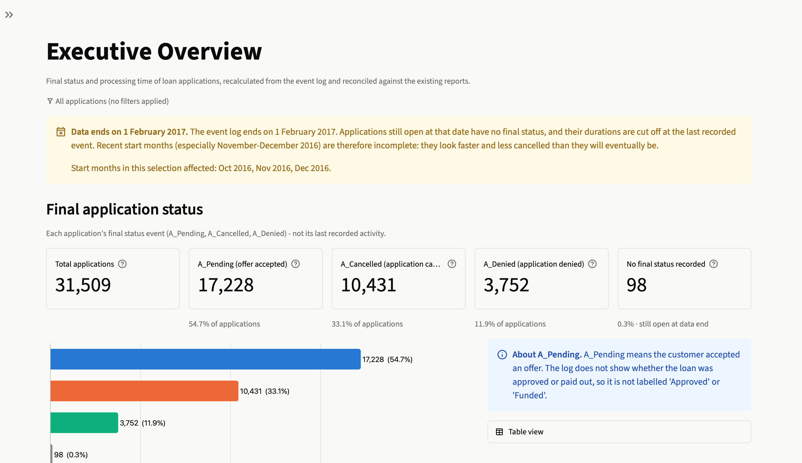
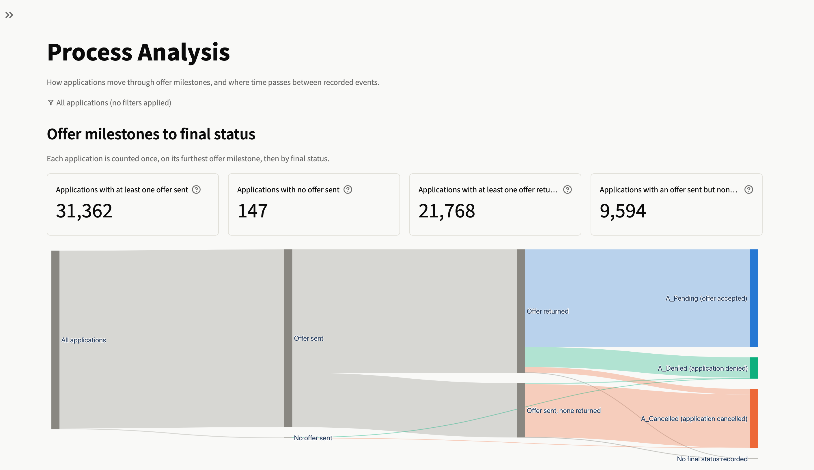
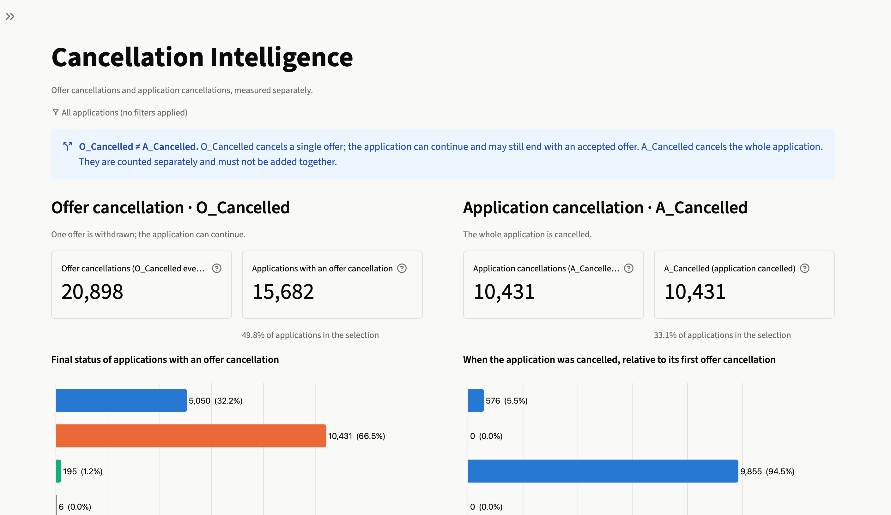
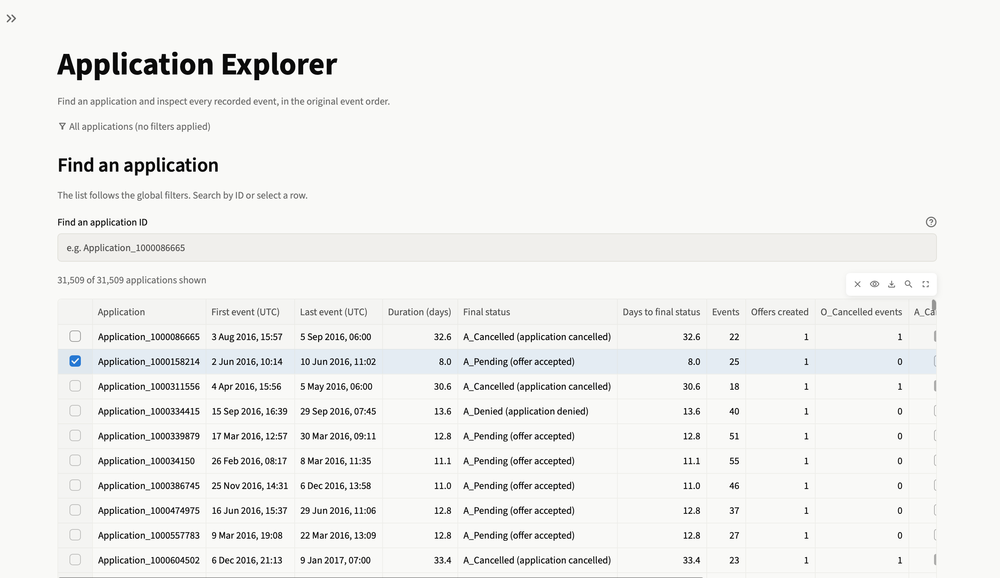
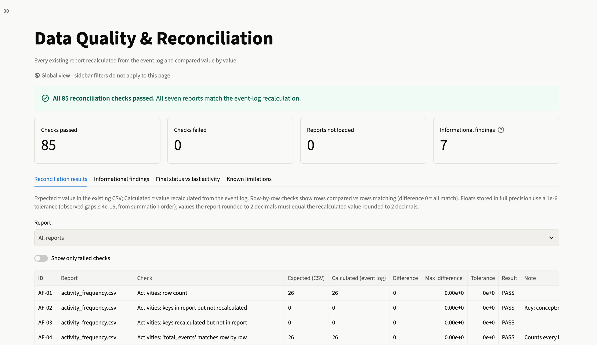

# Loan Application Process Intelligence Dashboard

**Process mining and business intelligence on a real bank's loan-application event log.**
The project turns 1.2 million raw events into a governed set of outcome, timing and
cancellation metrics. Every figure is reconciled against independent reports and covered
by automated tests.


| | |
|---|---|
| **Data** | BPI Challenge 2017 · 31,509 loan applications · 1,202,267 events · 26 activities · 1 Jan 2016 - 1 Feb 2017 |
| **Dashboard** | 5 interactive pages: Executive Overview · Process Analysis · Cancellation Intelligence · Application Explorer · Data Quality & Reconciliation |
| **Quality** | 566 automated tests · 98 % branch coverage · 0 warnings · 85 reconciliation checks pass, 0 fail |
| **Stack** | Python · pandas · NumPy · PyArrow · Plotly · Streamlit · pytest · pm4py (data preparation) |
| **Author** | Gaurav Solanki |

> The application lives in [`dashboard/`](dashboard/). Its technical documentation is
> [`dashboard/README.md`](dashboard/README.md), which covers the full metric definitions,
> architecture and test design.

---

## Dashboard preview



*Executive Overview: final status of all 31,509 applications. A_Pending is labelled as
offer accepted, and the warning that the data ends on 1 February 2017 is shown
prominently. All screenshots show the full dataset with no filters applied.*

---

## Contents

1. [Executive summary](#executive-summary)
2. [Dashboard pages](#dashboard-pages)
3. [Business questions addressed](#business-questions-addressed)
4. [Key analytical findings](#key-analytical-findings)
5. [Technology stack](#technology-stack)
6. [Dataset and terms of use](#dataset-and-terms-of-use)
7. [Data processing and analytical methodology](#data-processing-and-analytical-methodology)
8. [Data quality and reconciliation](#data-quality-and-reconciliation)
9. [Important analytical limitations](#important-analytical-limitations)
10. [Project structure](#project-structure)
11. [Installation and setup (macOS)](#installation-and-setup-macos)
12. [Launching the dashboard](#launching-the-dashboard)
13. [Future improvements](#future-improvements)
14. [Documentation, author and licence](#documentation-author-and-licence)

---

## Executive summary

A consumer-loan department needs to know four things:

* where its applications end up;
* how long they take;
* why so many are cancelled;
* where time is lost.

Its event log interleaves three streams (application states, offers and workflow tasks),
and many of the events are written automatically. A naive analysis of such a log gives
wrong answers in four ways:

* the last recorded activity is mistaken for the outcome;
* offer cancellations are confused with application cancellations;
* likely automatic timers look like staff bottlenecks;
* recent months look artificially fast.

This project answers the business questions and makes those traps explicit:

* **Outcomes.** Of 31,509 applications, 54.7 % ended in **A_Pending (offer accepted)**,
  33.1 % in **A_Cancelled** and 11.9 % in **A_Denied**. **98 applications (0.3 %) have no
  final status**: they were still open when the data ends, and they stay visible rather
  than being dropped.
* **Two kinds of cancellation.** Half of all applications (49.8 %) had an offer withdrawn
  (**O_Cancelled**), yet 5,050 of them still went on to accept an offer. An application
  cancellation (**A_Cancelled**) almost always comes first: 94.5 % happened before any
  offer cancellation.
* **A likely expiry pattern (exploratory).** 76 % of application cancellations are
  recorded by User_1 (likely, but not confirmed, a system account) at least 30 days after
  the last offer was sent. This is consistent with an automatic expiry rule, not a
  confirmed business rule.
* **Waiting time.** The two longest median waits between recorded events end in
  A_Cancelled and are likely timer-driven (exploratory), so they are not presented as
  staff performance problems.
* **Trust.** All metrics come from one central definition registry, and all seven
  existing analytical reports reconcile: **85 checks pass, 0 fail**.

---

## Dashboard pages

The first four pages share one set of global filters (start month, loan goal, application
type and final status), shown as removable chips. The Data Quality page always shows the
whole dataset. Clicking a chart either sets a global filter or
makes a page-level selection, and each chart's caption says which. Every table can be
downloaded as CSV with exactly the rows shown.

### 1. Executive Overview


* Headline KPIs: total applications, A_Pending (offer accepted), A_Cancelled, A_Denied
  and no final status recorded.
* Final status distribution.
* Applications by start month, stacked by final status. The incomplete months are faded
  and labelled.
* Median and 90th-percentile duration by start month.
* **Interaction:** click a status bar or a month to filter every page.

### 2. Process Analysis



* Sankey diagram from each application's furthest offer milestone to its final status,
  with a table view.
* Transition matrix of all 178 activity pairs, coloured by median wait or by count.
* The 15 longest median waits.
* Waiting-time drill-down with a histogram and every individual occurrence.
* Activity frequency, for all lifecycle stages or completed events only.

### 3. Cancellation Intelligence



* Offer cancellation (O_Cancelled) and application cancellation (A_Cancelled) side by
  side. They are measured separately and never added together.
* Final status of applications that had an offer cancellation.
* When the application was cancelled, relative to its first offer cancellation.
* Histogram of the likely automatic expiry (exploratory).
* Five offer-first follow-up patterns with their gap distribution.
* A filterable case table. Any application can be opened in the Application Explorer.

### 4. Application Explorer



* Search for an application or select one from the filtered list.
* Summary for the selected application.
* Event timeline in Application, Offer and Workflow lanes, with offer lifelines and the
  final-status event.
* The complete event table in the original recorded order.
* **Interaction:** click an event to select its table row (and vice versa), zoom and pan
  the timeline, and download the events.

### 5. Data Quality & Reconciliation



* Reconciliation results (PASS / FAIL / ERROR), kept separate from informational findings.
* Final status versus last recorded activity.
* CreditScore = 0 analysis.
* Report availability.
* This page shows the whole dataset; the global filters do not apply.

---

## Business questions addressed

1. What final status do applications reach, and what share remain open?
2. How long do applications take, and how does this change by start month?
3. How many applications receive, return and accept an offer?
4. How common are offer cancellations compared with application cancellations, and how
   are they related?
5. How many application cancellations look like an automatic expiry rather than a
   decision?
6. What happens between an offer cancellation and a later application cancellation?
7. Where does time pass between recorded events, and which long waits are likely system
   timers?
8. What exactly happened in one specific application?
9. Do the dashboard's figures agree with the existing analytical reports?

---

## Key analytical findings

All figures are recalculated from the event log for the full dataset and reconciled with
the reports in `reports/`. The documentation tests check every number against the code.

**Final status**

| Final status | Applications | Share |
|---|---:|---:|
| A_Pending (offer accepted) | 17,228 | 54.7 % |
| A_Cancelled (application cancelled) | 10,431 | 33.1 % |
| A_Denied (application denied) | 3,752 | 11.9 % |
| No final status recorded (open on 1 Feb 2017) | 98 | 0.3 % |

* **A_Pending means the customer accepted an offer.** The log does not record whether
  the loan was approved or funded, so the dashboard never labels it that way.
* **Processing time:**
  * median 19.1 days from first to last event (90th percentile 35.1 days);
  * median 19.1 days to the final-status event, for the 31,411 applications that reached
    one.

**Offers**

* 42,995 offers created, 41,733 sent and 23,305 returned (a 55.8 % return rate).
* Outcomes: 17,228 accepted, 4,695 refused, 20,898 cancelled and 174 without an outcome.
* 31,362 applications had at least one offer sent. Of those, 21,768 had an offer
  returned and 9,594 had none returned.

**Offer cancellation is not application cancellation**

* **O_Cancelled (one offer withdrawn):** 20,898 events in 15,682 applications (49.8 %).
  The application can continue: 5,050 of these applications still reached A_Pending
  (offer accepted).
* **A_Cancelled (the whole application cancelled):** 10,431 applications. In 9,855
  (94.5 %) the application was cancelled before any offer cancellation; in 576 (5.5 %) an
  offer was cancelled first.
* **Offer-first cancellations:** all 576 still ended A_Cancelled, even those that
  received a replacement offer, so this is not customer recovery.
* **Likely automatic expiry (exploratory):** 7,932 of the 10,431 A_Cancelled events
  (76 %) were recorded by User_1 (likely, but not confirmed, a system account) at least
  30 days after the last offer was sent.

**Waiting time between recorded events**

* **The two longest median waits** both end in A_Cancelled and are likely timer-driven
  (exploratory):
  * O_Sent (mail and online) → A_Cancelled: median 736 h, about 31 days;
  * W_Call after offers → A_Cancelled: median 641 h, about 27 days.
* **The remaining longest waits** are 68-92 hours, mostly around the "call after offers"
  follow-up step. They are gaps between consecutive recorded events in parallel streams:
  they show where time passes, not proven staff bottlenecks.

---

## Technology stack

| Purpose | Tools (versions tested) |
|---|---|
| Language | Python 3.14 |
| Data processing | pandas 3.1.1, NumPy 2.5.4, PyArrow 26.0.1 |
| Visualisation | Plotly 7.1.0 |
| Dashboard | Streamlit 1.67.0 (multipage navigation, cached data, chart and table selections) |
| Testing | pytest 9.2.0, pytest-cov 7.1.0, Streamlit AppTest |
| Data preparation | pm4py 2.7.23.12 (XES import only) |

---

## Dataset and terms of use

**BPI Challenge 2017**: the loan-application event log of a Dutch financial institute,
published for the Business Process Intelligence Challenge 2017. The dataset was created
by Boudewijn van Dongen and is published by 4TU.ResearchData. This project does not own
it.

* **Citation:** van Dongen, Boudewijn (2017): BPI Challenge 2017. 4TU.ResearchData. Dataset.
  <https://doi.org/10.4121/uuid:5f3067df-f10b-45da-b98b-86ae4c7a310b>
* **Terms:** the dataset is published under the
  [4TU General Terms of Use](https://doi.org/10.4121/resource:terms_of_use) (August 2016).
  In summary:
  * acknowledge the source and its rights-holder (the creator named above);
  * the data may be remixed, transformed or built upon **for non-commercial purposes
    only**;
  * anyone who distributes the data must also require onward distributors to keep this
    acknowledgement.

  Read the full terms before reusing the data.
* **Structure of the log:**

  | Stream | Prefix | Examples |
  |---|---|---|
  | Application | `A_` | A_Create Application, A_Submitted, A_Pending, A_Cancelled, A_Denied |
  | Offer | `O_` | O_Create Offer, O_Sent (mail and online), O_Returned, O_Accepted, O_Cancelled |
  | Workflow | `W_` | W_Validate application, W_Call after offers (with lifecycle stages such as schedule, start, suspend, resume and complete) |

* **What this repository contains:**
  * The raw event log (`data/raw/BPI Challenge 2017.xes`, about 552 MB) and the processed
    file (`data/processed/loan_application_events.parquet`, about 24 MB) are **not**
    included. Download the log from the DOI above and build the processed file as
    described in the [setup instructions](#installation-and-setup-macos).
  * The seven CSV files in `reports/` and the dashboard's outputs (charts, tables, CSV
    downloads, screenshots) are **derived** from the dataset. They are covered by the
    4TU General Terms of Use, not by this project's MIT licence: use them for
    **non-commercial purposes only**, and keep the acknowledgement of the source and its
    creator (the citation above) whenever you share them.

---

## Data processing and analytical methodology

1. **Ingest.** `src/ingest_data.py` reads the XES log with pm4py, standardises
   timestamps to UTC and writes a Parquet file.
2. **Load safely.** The dashboard loads the Parquet file read-only and checks its schema.
   Events are ordered by application, then timestamp; ties keep the original file order.
3. **Calculate.** All KPIs are calculated in a Streamlit-free analytical layer
   (`dashboard/core/`). Each one has a single definition in a central registry
   (`core/definitions.py`, 31 entries), which the KPI cards, tooltips and tests all use.
4. **Reconcile.** Each of the seven existing reports is recalculated from the event log
   and compared value by value.
5. **Present.** The pages call a thin presentation layer. They never calculate metrics
   themselves, and every result they receive is a cached copy keyed by the current
   filters.

| Concept | Definition used |
|---|---|
| **Final status** | The activity of the application's *last* A_Pending / A_Cancelled / A_Denied event. Applications without one are reported as "No final status recorded" (98) and never dropped. |
| **A_Pending** | "A_Pending (offer accepted)": offer acceptance only, not a loan decision. |
| **O_Cancelled vs A_Cancelled** | O_Cancelled withdraws one offer; A_Cancelled cancels the application. They are always counted and shown separately. |
| **Duration** | From the first to the last recorded event. Time to final status is a separate measure. |
| **Transition / wait** | An event and the next recorded event of the same application; the wait is the time between them. Streams interleave, so a transition is an order of recorded events, not necessarily a hand-off. |
| **Likely timer-driven (exploratory)** | A pair whose target events are ≥ 80 % recorded by User_1 and whose median wait is ≥ 24 h. |
| **Likely automatic expiry (exploratory)** | An A_Cancelled event recorded by User_1 at least 30 days after the last O_Sent. |
| **Workflow events** | Shown as individual events. Their lifecycle stages cannot be paired reliably, so no task durations are calculated. |
| **CreditScore = 0** | Treated as potentially missing: excluded from averages and reported as a count. |
| **Dataset end** | Fixed at 1 February 2017 for all censoring calculations. |

The full definitions are in [`dashboard/README.md`](dashboard/README.md#6-data-definitions-and-methodology).

---

## Data quality and reconciliation

| Check | Result |
|---|---|
| Reconciliation against the seven existing CSV reports | **85 checks PASS · 0 FAIL** · 7 documented informational findings |
| Automated tests | **566 automated tests passed**, 0 failed, 0 skipped, 0 warnings (run with `-W error`) |
| Branch coverage | 98 % branch coverage |
| Source data protection | `data/`, `reports/` and `src/` are fingerprinted before and after the test run and stay byte-identical |

**Data-quality findings surfaced in the dashboard**

* **CreditScore:** the score is 0 on 27,735 of 42,995 offers (64.5 %). A zero is treated
  as potentially missing.
* **Last activity vs final status:** `reports/application_outcomes.csv` counts each
  application's **last recorded activity**. That is usually a workflow or offer event
  written after the decision, not the final application status. The dashboard shows both
  side by side.

**What the tests cover**

* every metric, on small hand-built logs with known answers and on the real data;
* each report, value by value;
* every page through Streamlit AppTest, including chart clicks, cross-page filters,
  downloads and wording;
* the read-only safety guards;
* every number quoted in the documentation.

---

## Important analytical limitations

* **The log ends on 1 February 2017.** Applications still open then have no final
  status (98), and their durations stop at the last recorded event.
* **October to December 2016 are incomplete start months.** They contain open
  applications and/or less than 60 days of observation, so they look faster and less often
  cancelled than they will eventually be. The dashboard fades and labels them wherever
  monthly trends appear.
* **Likely timers and expiry are exploratory.** Timer and expiry indicators are labelled
  "likely". They are not confirmed business rules, and the nature of User_1 is not
  documented.
* **Interleaved streams.** Waits between consecutive events are not task or hand-off
  durations, and workflow task durations are not calculated.
* **No loan decision or payout data.** A_Pending marks offer acceptance only.
* **CreditScore** is 0 on most offers and cannot be relied on for credit analysis.

**Known repository limitations**

* **Unusual folder names in `src/`** (kept as-is, because `src/` is treated as read-only):
  * `src/ src/` has a leading space in its name. It holds `analyze_outcomes.py`.
  * `src/reports/` and the nested `src/src/` folders are empty. Git does not track empty
    folders, so they do not appear in the repository.
* **Reports without a generating script:** three reports in `reports/` have no generating
  script in `src/`. The dashboard reconciles them but cannot regenerate them:
  * `cancellation_completion_delays.csv`
  * `offer_cancellation_followup_patterns.csv`
  * `offer_cancellation_pattern_summary.csv`

---

## Project structure

```
AI-Process-Automation/
├── dashboard/                  # the Streamlit application  <- start here
│   ├── app.py                  #   entry point: navigation, sidebar filters, error handling
│   ├── core/                   #   analytical layer (no Streamlit): metrics, definitions, reconciliation
│   ├── ui/                     #   presentation layer: data bridge, filters, selections, charts
│   ├── views/                  #   one file per dashboard page
│   ├── tests/                  #   unit, integration, AppTest UI and documentation tests
│   ├── docs/                   #   demo guide and repository audit
│   ├── .streamlit/config.toml
│   ├── requirements.txt        #   dashboard runtime dependencies
│   └── requirements-dev.txt    #   + test dependencies
├── docs/images/                # dashboard screenshots used in this README
├── reports/                    # seven analytical reports (CSV) derived from the dataset
├── src/                        # original data-preparation and analysis scripts
├── data/                       # local only, not in the repository
│   ├── raw/BPI Challenge 2017.xes
│   └── processed/loan_application_events.parquet
├── requirements-data.txt       # data-preparation dependencies (dashboard pins + pm4py)
├── LICENSE
└── README.md
```

---

## Installation and setup (macOS)

**Prerequisites**

* macOS with Python 3.14 (the tested version). Check with `python3 --version`.
* Git.
* About 600 MB of free disk space for the raw dataset.

**1. Get the code**

```bash
git clone <repository-url> AI-Process-Automation
cd AI-Process-Automation
```

**2. Create a virtual environment and install the dashboard and test dependencies**

```bash
python3 -m venv .venv
.venv/bin/python -m pip install -r dashboard/requirements-dev.txt
```

**3. Prepare the data.** The repository does not contain the data. The dashboard reads
`data/processed/loan_application_events.parquet`, which you build from the raw log:

```bash
# Download the log from the DOI above and save it as "data/raw/BPI Challenge 2017.xes", then:
.venv/bin/python -m pip install -r requirements-data.txt   # adds pm4py, the XES reader
.venv/bin/python src/ingest_data.py
```

[`requirements-data.txt`](requirements-data.txt) includes the dashboard's pinned packages
and pins `pm4py==2.7.23.12`. It is needed only for this step.

**4. Run the tests (optional)**

```bash
cd dashboard
../.venv/bin/python -m pytest -W error                       # complete suite
../.venv/bin/python -m pytest -W error -m "not integration"  # fast unit tests only
cd ..
```

The integration and UI tests need the processed Parquet file and the reports in `reports/`.

---

## Launching the dashboard

```bash
cd dashboard
../.venv/bin/streamlit run app.py
```

* Streamlit serves the app at <http://localhost:8501>, bound to this machine only (see
  `dashboard/.streamlit/config.toml`).
* The first page load reads the 1.2 million events, which takes a few seconds. Later
  interactions use cached results.
* Stop the server with `Ctrl+C`.

---

## Future improvements

* Confirm the nature of User_1 and the expiry rule with the process owner. Then promote
  the exploratory indicators to confirmed metrics.
* Add conformance checking against a reference process model.
* Use survival analysis (for example Kaplan-Meier) to handle right-censored durations
  formally.
* Add generating scripts for the three reports that lack one.
* Containerise the dashboard and add authentication before sharing it beyond a single
  machine.

---

## Documentation, author and licence

| Document | Purpose |
|---|---|
| [dashboard/README.md](dashboard/README.md) | Full technical documentation: definitions, architecture, caching, testing |
| [dashboard/docs/DEMO_GUIDE.md](dashboard/docs/DEMO_GUIDE.md) | How to present the dashboard: page order, KPIs, a 3-5 minute script, interview questions |
| [dashboard/docs/GITHUB_READINESS.md](dashboard/docs/GITHUB_READINESS.md) | Repository audit: secrets, large files, what is and is not committed |
| [LICENSE](LICENSE) | MIT licence for the project's own code, and its scope |

### Author

**Gaurav Solanki**

<!-- TODO (owner): add the profile links you want to show (LinkedIn / GitHub / portfolio). -->
*Profile links to be added.*

### Licence

* **Code:** the project's original source code and documentation are released under the
  [MIT License](LICENSE). This covers the dashboard, its tests and documentation, and the
  scripts in `src/`.
* **Data:** the MIT licence **does not cover** the BPI Challenge 2017 dataset or anything
  derived from it, including the reports in `reports/` and the dashboard screenshots.
  That data remains under the 4TU General Terms of Use described above.
